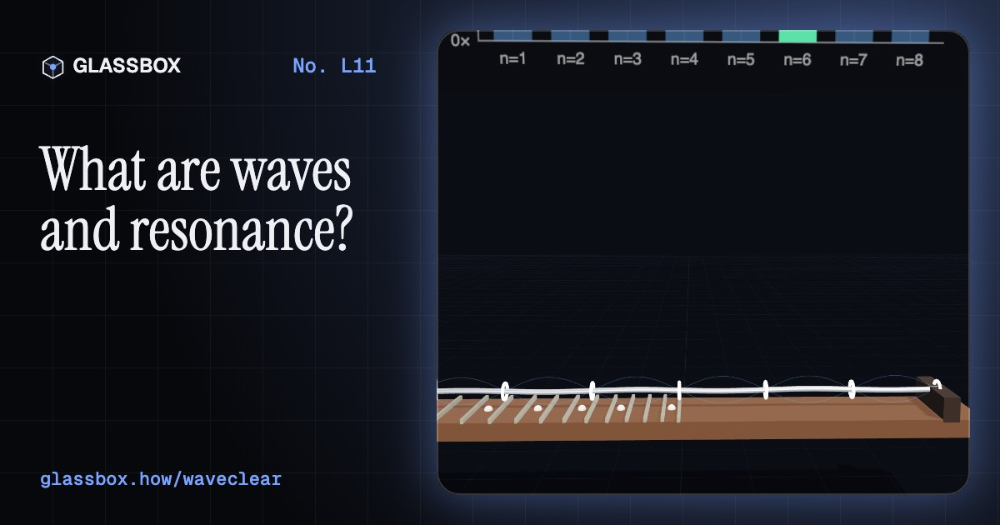
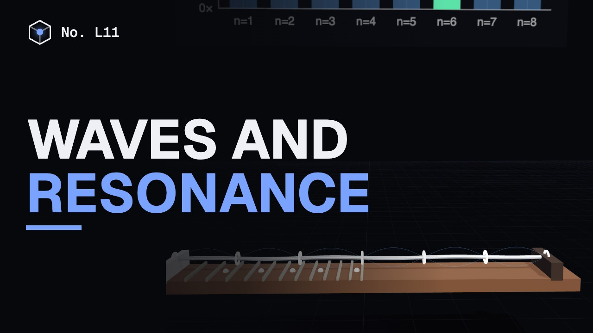
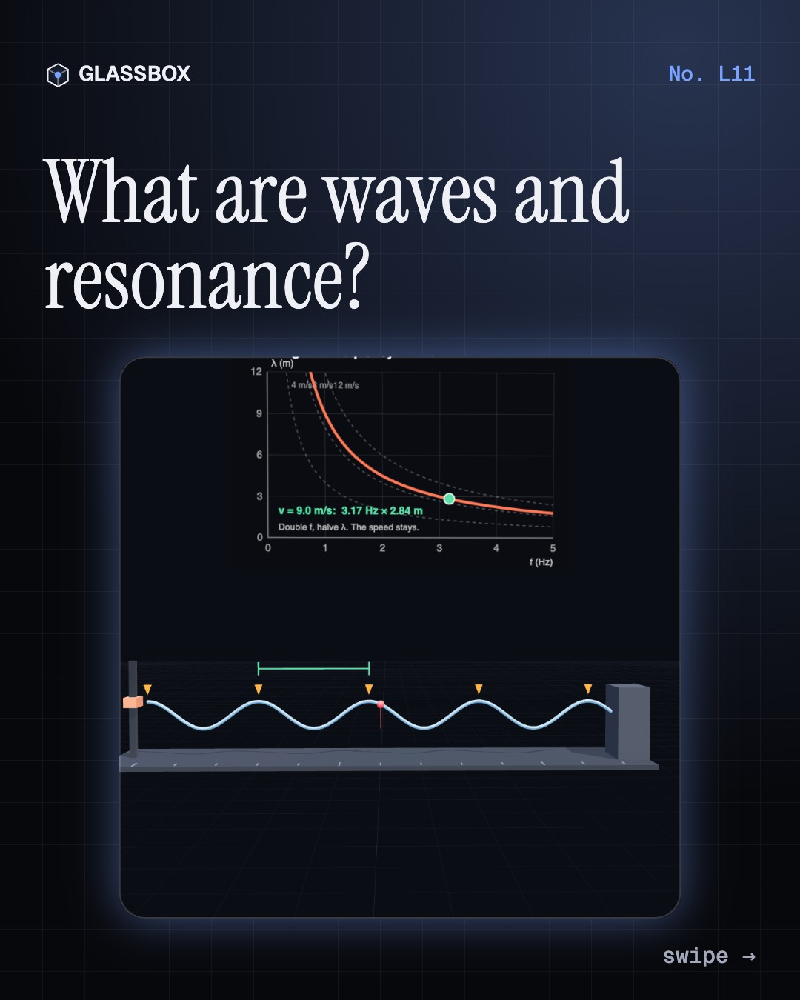
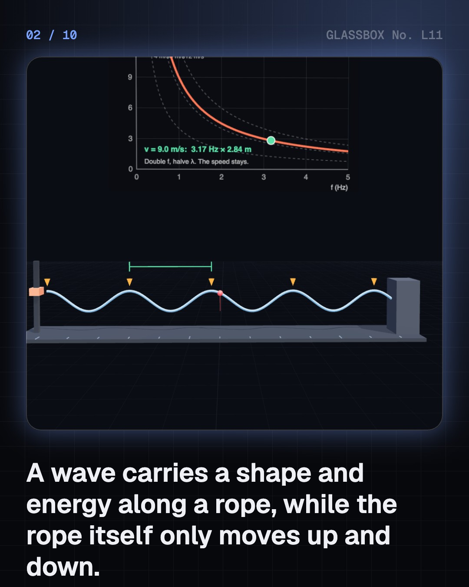
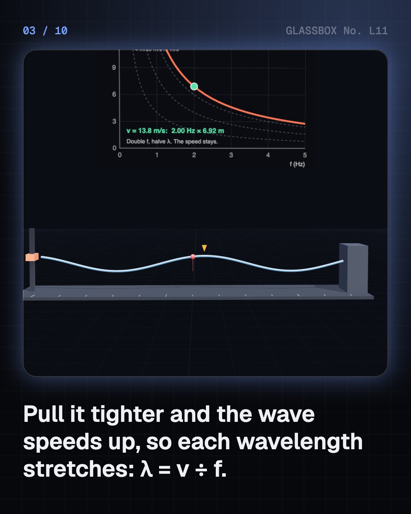
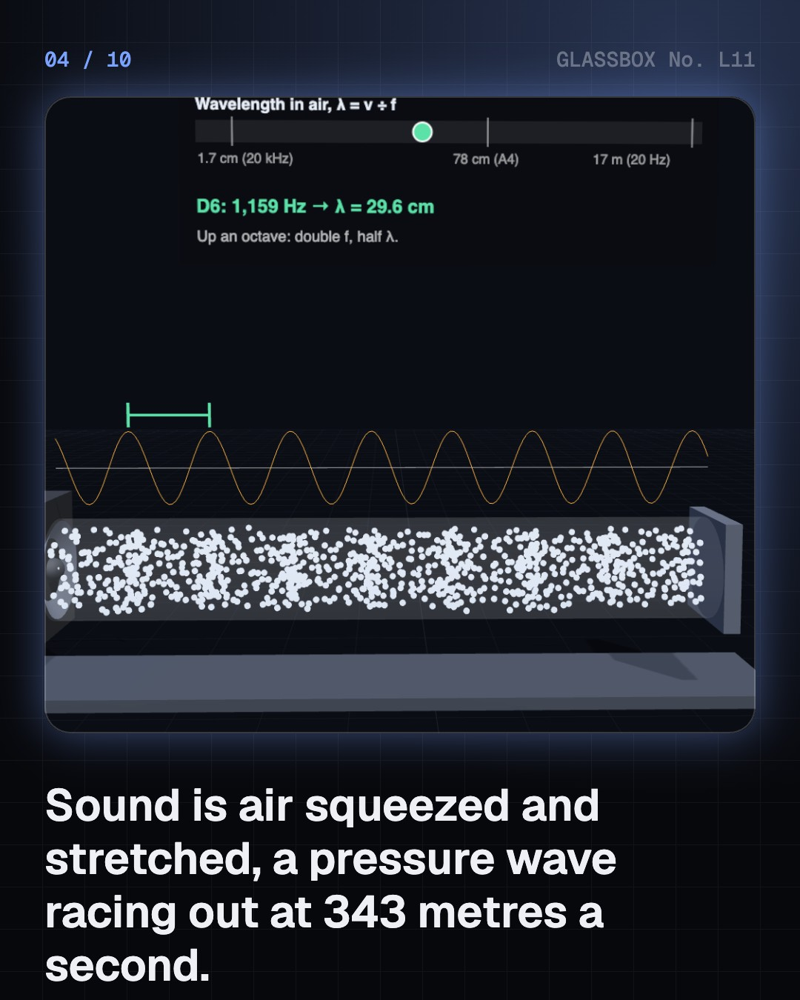

<!-- glassbox:start -->
<!-- Generated from glassbox.json by the Glassbox hub (npm run readme -- waveclear). Edit glassbox.json, not this block. -->
<p align="center"><a href="https://glassbox.how/e/waveclear/"></a></p>

<h1 align="center">Waves and resonance</h1>

<p align="center"><b>What are waves and resonance?</b><br>Shake a rope, pluck a string, switch on a microwave: it's the same rule every time, speed = frequency × wavelength. Play with waves on a rope, in air and in light, push a swing and a washing machine into resonance, and find out what really brought down the Tacoma Narrows Bridge.</p>

<p align="center"><a href="https://glassbox.how/waveclear/"><b>▶ Play with it</b></a> &nbsp;·&nbsp; <a href="https://glassbox.how/e/waveclear/">Read the 60-second explainer</a> &nbsp;·&nbsp; <a href="https://glassbox.how/waveclear/glassbox/reel.mp4">Watch the 40-second video</a></p>

<p align="center">
  <a href="https://glassbox.how/e/waveclear/"></a>
  <a href="https://glassbox.how/e/waveclear/"></a>
  <a href="LICENSE"></a>
  <a href="LICENSE-CONTENT.md"></a>
  <a href="#privacy"></a>
</p>

## In 60 seconds

1. **A wave carries energy, not stuff.** Shake a rope and a shape runs along it while each bit of rope only goes up and down. Each shake sends one wavelength, so v = f × λ. The speed belongs to the rope; shaking faster only packs the crests closer.
2. **Sound is squeezed air.** A loudspeaker pushes air into bunches that race away at 343 m/s. Pitch is frequency: A4 is 440 Hz with 78 cm waves. A string or pipe fixed at its ends rings only at fₙ = n v ÷ 2L, the harmonics.
3. **Light is a wave too.** Radio, microwaves, light and X-rays are electromagnetic waves, all at c. A microwave oven's 2.45 GHz waves are 12.2 cm long, making hot spots 6 cm apart, and the door's tiny holes turn them back while light gets out.
4. **Resonance: push in step.** Everything that can wobble has a natural frequency. Push at that rhythm, like a swing every 3 s, and small pushes add up until damping balances them. Washers shudder as they spin through it; a wine glass can shatter.
5. **Surprises and a myth.** Waves add, so they can cancel: calm lines between ripples, beats between close notes. Sound needs a medium, light doesn't. And Tacoma Narrows wasn't simple resonance: a steady wind fed a twisting flutter.

## Words worth knowing

| Term | Meaning |
|---|---|
| **Frequency (f)** | How many waves pass a point each second, in hertz (Hz). |
| **Wavelength (λ)** | The distance from one crest to the next. |
| **Wave speed** | How fast the pattern travels: v = f × λ. Set by the medium, not the source. |
| **Standing wave** | Two waves travelling opposite ways that add into a pattern of fixed nodes and antinodes. |
| **Harmonics** | The whole-number multiples of a string's or pipe's lowest frequency: fₙ = n v ÷ 2L. |
| **Electromagnetic wave** | Linked electric and magnetic fields travelling at c = 299,792 km/s, even through empty space. |
| **Resonance** | A large response when a system is driven at its own natural frequency. |
| **Interference** | Waves adding where they overlap: reinforcing in step, cancelling half a wave out of step. |

## A short history

**From Pythagoras's strings to ripples in spacetime: how people learned that sound, light and even gravity travel as waves.**

- **530 BCE** · Whole-number strings sound sweet (Pythagoras and his followers (attributed), Croton, Magna Graecia)
- **1636** · Mersenne's laws of strings (Marin Mersenne, Paris)
- **1687** · Newton calculates the speed of sound (Isaac Newton, Cambridge)
- **1787** · Sand draws the nodes (Ernst Chladni, Wittenberg)
- **1801** · Light makes interference fringes (Thomas Young, Royal Society, London)
- **1842** · Moving sources change pitch (Christian Doppler, Prague)
- **1865** · Light is an electromagnetic wave (James Clerk Maxwell, London)
- **1887** · Hertz makes radio waves (Heinrich Hertz, Karlsruhe)

The full story, with 19 moments, charts, people and 27 sources: [glassbox.how/e/waveclear/history](https://glassbox.how/e/waveclear/history/). The data lives in [`history.json`](history.json).

## Video and slides

Made with the Glassbox studio from this box's storyboard (`window.glassbox.director`). Free to reuse under CC BY 4.0.

<a href="https://glassbox.how/waveclear/glassbox/video.mp4"></a>

<p><a href="glassbox/slide-1.jpg"></a> <a href="glassbox/slide-2.jpg"></a> <a href="glassbox/slide-3.jpg"></a> <a href="glassbox/slide-4.jpg"></a></p>

| File | What | Size |
|---|---|---|
| [`glassbox/reel.mp4`](https://glassbox.how/waveclear/glassbox/reel.mp4) | Reel / Short, with captions and soundtrack | 1080×1920 |
| [`glassbox/video.mp4`](https://glassbox.how/waveclear/glassbox/video.mp4) | YouTube video, with captions and soundtrack | 1920×1080 |
| `glassbox/slide-1…10.jpg` | Instagram carousel | 1080×1350 |
| `glassbox/thumb.jpg` | YouTube thumbnail | 1280×720 |
| `glassbox/cover.jpg` | Share card and repo social preview | 1200×630 |
| [`glassbox/history-reel.mp4`](https://glassbox.how/waveclear/glassbox/history-reel.mp4) | “History in 10 moments” Reel / Short | 1080×1920 |
| `glassbox/history-slide-*.jpg` | History carousel | 1080×1350 |
| `glassbox/post.json` | Post copy and schedule used by the publish kit | |

## Privacy

This box has no accounts and no ads, and it ships its own fonts and libraries. When you run it yourself it sends nothing anywhere. On glassbox.how, the site's `/bar.js` also loads Glassbox's analytics: **Google Analytics** to count visits (it asks first in the EU, UK and Switzerland, and stays off when your browser sends Global Privacy Control or Do Not Track) and **ClickTrust** to detect bots.

It remembers a few things **in your own browser only**, and never sends them anywhere:

| Browser storage key | What it holds |
|---|---|
| `waveclear.v1` | Which chapters you have opened, your best quiz scores, and sound on or off. |

Exactly what each one sees is at [glassbox.how/privacy](https://glassbox.how/privacy/).

## Licences

- **Code:** [MIT](LICENSE). Use it, change it, ship it.
- **Explanations, text, images and videos** (`glassbox.json`, `glassbox/`): [CC BY 4.0](LICENSE-CONTENT.md). Credit “Glassbox, glassbox.how/e/waveclear”.
- **Third-party parts** keep their own licences: [three.js](https://threejs.org) (MIT), [Geist, Instrument Serif](https://openfontlicense.org) (SIL OFL 1.1).
- The Glassbox name and logo aren't covered by either licence. See the [terms](https://glassbox.how/terms/).

Found a mistake? [Open an issue](https://github.com/bdeeps/waveclear/issues). Corrections happen in public.
<!-- glassbox:end -->

## Run it

It's plain HTML, CSS and JavaScript. No build step and no dependencies. Run locally, it contacts no other website.

```bash
python3 -m http.server 8000
```

Three.js and the fonts ship in `vendor/` and `fonts/`, so it also works offline.

Then open http://localhost:8000.

## How it's built

| File | What |
|---|---|
| `index.html`, `css/app.css` | The page and its styles |
| `js/app.js`, `js/stage.js`, `js/ui.js`, `js/kit.js` | The shared Glassbox 3D engine: chapters, 3D stage, controls, quiz, video director |
| `js/chapters/*.js` | One file per chapter: the 3D model, controls, text, key terms, quiz and video scenes |
| `js/wave.js` | Shared wave maths (v = f λ, notes, a driven oscillator, wavelength colours), chart boards, tones and layout helpers |
| `glassbox.json` | Title, question, explainer beats, key terms, browser storage and credits shown on glassbox.how |
| `reel` in each chapter | The storyboard the Glassbox studio records into short videos |
| `glassbox/` | The published video, slides, thumbnail and post copy |
| `fonts/`, `vendor/three/` | Self-hosted Geist and Instrument Serif (SIL OFL 1.1) and three.js (MIT) |
